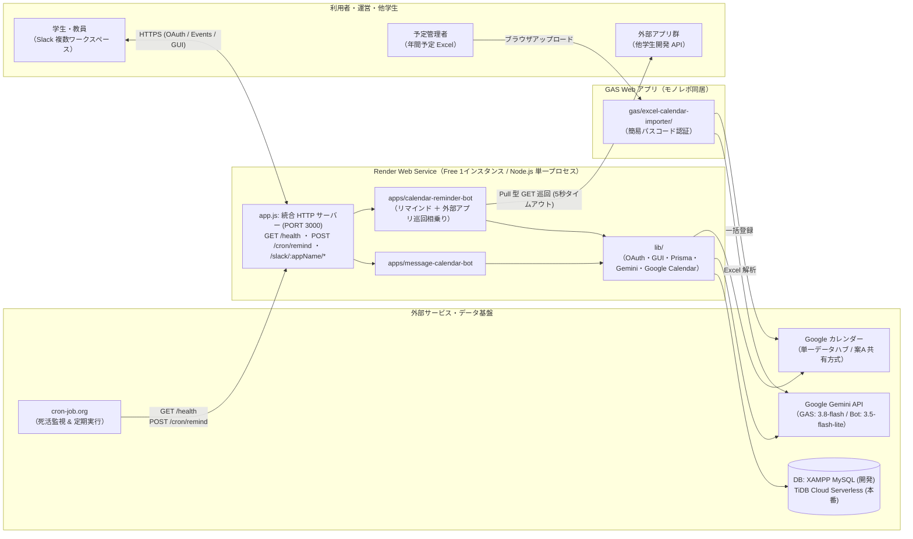

# 学内予定管理・通知連携システム (`slack-extension-app`)

Google カレンダーを単一のデータハブ（Single Source of Truth）とし、**年間行事予定の取り込み・Slack からの予定登録・定期リマインドおよび学生開発の外部アプリ通知** を Slack へ集約するためのモノレポ開発リポジトリです。

Node.js マルチ Bot 相乗り基盤（Render 1インスタンス）と Google Apps Script（GAS）Web アプリを同一リポジトリ内で管理し、**非エンジニアでも迷わず導入・設定できる GUI ファースト設計** を採用しています。

---

## 1. プロジェクト概要と 3 サブシステム構成

### 3 つのサブシステム

| サブシステム | 配置先 | 主な役割 |
| :--- | :--- | :--- |
| **① 年間行事予定インポーター**<br>（GAS Web アプリ） | `gas/excel-calendar-importer/`<br>*(タスク3で雛形配置予定)* | 年間行事予定 Excel をブラウザから読み込み、AI（Gemini）で予定を抽出して複数の校内共有 Google カレンダーへ一括登録する（チーム共通アカウントで「自分として実行」＋簡易パスコード認証）。 |
| **② Slack 予定登録 Bot** | `apps/message-calendar-bot/` | Slack 投稿への 📅 / 📆 リアクションを起点に AI で予定を抽出し、ワークスペースごとに DB 管理された共有 Google カレンダーへ登録する（`✅` 付与・重複登録防止・Slack 上での予定削除を含む MVP）。 |
| **③ 予定リマインド ＋ 外部アプリ連携通知 Bot** | `apps/calendar-reminder-bot/` | `cron-job.org` からの定期実行をトリガーに、① Google カレンダーの予定リマインド、② 他学生が開発した外部アプリ API からの Pull 型通知を同一チャンネルへ配信する（1 API 5秒タイムアウト・重複通知防止）。 |

### システム全体構成図



---

## 2. ディレクトリ構成（モノレポ）

```text
slack-extension-app/
├── app.js                                 # 統合 HTTP サーバー兼オーケストレーター（PORT 3000）
├── package.json                           # Node.js 依存関係・実行スクリプト
├── prisma7.config.ts                      # Prisma 7 設定（スキーマ・マイグレーションパス・DB URL）
├── biome.json                             # Linter / Formatter 設定（gas/ は除外予定）
├── AGENTS.md                              # 開発ルール・AI エージェント共通指示書（正本）
├── .env.sample                            # 環境変数テンプレート（秘密情報は記載禁止）
├── apps/
│   ├── index.js                           # apps/ 配下の Bot を自動走査するローダー
│   ├── message-calendar-bot/              # Bot①: Slack 投稿からの予定登録 Bot
│   │   ├── index.js                       # OAuth / Socket Mode 両対応の初期化
│   │   ├── manifest.json                  # Slack App Manifest
│   │   └── listeners/                     # Slack イベント・UI リスナー
│   └── calendar-reminder-bot/             # Bot②: リマインド ＋ 外部アプリ通知 Bot
│       ├── index.js
│       ├── manifest.json
│       ├── listeners/
│       └── services/
│           └── reminder-service.js        # リマインド配信サービス（外部連携サービスもここへ追加予定）
├── lib/                                   # 全 Bot 共有の共通基盤レイヤ
│   ├── prisma.js                          # PrismaClient シングルトン
│   ├── slack-app-factory.js               # OAuth 本番配布 / Socket Mode 自動切替ファクトリ
│   ├── slack-installation-store.js        # ワークスペース別 OAuth トークンの DB 保存・復元
│   ├── slack-setup-ui.js                  # 共通 GUI（App Home・設定モーダル・インストール直後 DM）
│   ├── google-calendar.js                 # Google カレンダー操作（案A: サービスアカウント認証）
│   └── gemini.js                          # Gemini API 共通インターフェイス
├── routes/
│   └── cron.js                            # POST /cron/remind 受付（CRON_SECRET 検証付き）
├── prisma/
│   ├── schema.prisma                      # DB スキーマ定義
│   └── migrations/                        # Prisma Migrate SQL 履歴
├── gas/                                   # 【モノレポ同居・タスク3で雛形配置予定】
│   └── excel-calendar-importer/           # GAS Web アプリ（code.gs / index.html / appsscript.json）
├── scripts/
│   └── create-app.js                      # 新規 Bot 雛形生成 CLI
├── tests/                                 # node:test による単体テスト群（*.spec.js）
└── docs/                                  # 設計書（docs/specs/）・ガイドライン・Wiki 原稿
```

---

## 3. 技術スタック ＆ Gemini API 運用方針

### 基盤・ホスティング

| カテゴリ | 採用技術・運用方針 |
| :--- | :--- |
| **実行環境 / 言語** | Node.js 18 以上（推奨 20 LTS）、ES Modules（`"type": "module"`） |
| **Slack フレームワーク** | `@slack/bolt` v5（本番: OAuth 2.0 Direct Install / 開発: Socket Mode 両対応） |
| **UI / UX** | スラッシュコマンドは使わず、**App Home ダッシュボード ＋ モーダル ＋ インストール直後 DM** の GUI に一本化 |
| **データベース / ORM** | MySQL 互換（ローカル: XAMPP / 本番: TiDB Cloud Serverless）、Prisma 7（`prisma migrate` で履歴管理） |
| **ホスティング / 定期実行** | Render Web Service（Free 1インスタンスに全 Bot 相乗り）、`cron-job.org`（死活監視＆定期リマインド） |
| **Google カレンダー連携** | サービスアカウント共有方式（案A）。チーム共通 Google アカウント（`akitacore.stamina@gmail.com`）で管理 |
| **テスト / Linter** | Node.js 標準テストランナー（`node:test` / `node:assert`）、Biome |

### Gemini API モデル選定・コスト・プライバシー方針

- **ハイブリッドモデル構成（Gemini 3系）**:
  - **GAS Web アプリ（Excel 年間予定解析）**: `gemini-3.8-flash`（思考レベル `thinkingLevel` を `minimal` または `low` に制御）
  - **Slack Bot（短文メッセージ解析）**: `gemini-3.5-flash-lite`（環境変数 `GEMINI_MODEL` で切替可能予定）
- **本番環境（有料枠・AI 学習 OFF）**:
  - 校内データが AI のモデル学習に利用されるのを防ぐため、本番環境では **Paid Tier（データ学習 OFF / No Training）** を使用します（標準利用の年間コスト見積もり：約 214〜262 円、Google Cloud 予算アラート月額 500 円設定）。
- **開発環境（モック ＆ 開発用無料枠の併用戦略）**:
  - 日常の UI / 機能実装および自動テスト（`npm test`）は **`MOCK_GEMINI=true`**（タスク3で実装予定・外部通信せず固定ダミー JSON を返却）で行います。
  - プロンプト検証時のみ、**請求先未設定の開発用 GCP プロジェクト（強制無料枠）** の API キーを使用します。

> [!CAUTION]
> **【厳守】開発用無料枠 API キーへの実データ入力の絶対禁止**  
> 無料枠 API キーは入力データが Google のモデル学習に使用される可能性があります。開発・検証時に無料枠キーを使う場合は、**実際の年間行事予定 Excel や、生徒・教員の実名・個人情報を含む実データを絶対に入力しないでください**。検証には必ず完全な架空データのみを使用してください。

---

## 4. 初心者向けローカル環境セットアップ手順

### 事前準備
- **Node.js 18 以上**（推奨 20 LTS）
- **XAMPP**（ローカル MySQL 用）
- **Git**

### Step 1: 依存パッケージのインストール

```powershell
npm install
```

### Step 2: ローカル DB（XAMPP MySQL）の起動とマイグレーション適用

1. **XAMPP Control Panel** を開き、**MySQL** の **「Start」** をクリックします。
2. phpMyAdmin（`http://localhost/phpmyadmin`）等で `slack_app_db` データベースを作成します（照合順序: `utf8mb4_unicode_ci`）。
3. `.env.sample` をコピーして `.env` を作成し、`DATABASE_URL` を有効化します：
   ```powershell
   Copy-Item .env.sample .env
   ```
   ```env
   DATABASE_URL="mysql://root:@localhost:3306/slack_app_db"
   ```
4. 初回マイグレーションを適用し、Prisma Client を生成します：
   ```powershell
   npx prisma migrate deploy --config prisma7.config.ts
   npx prisma generate --config prisma7.config.ts
   ```

### Step 3: 個人開発用の環境変数（`.env`）設定

衝突を防ぐため、開発メンバーは **自分専用のテスト用 Slack App（Socket Mode）** と **テスト用 Google カレンダー** を用意して `.env` に設定します。

1. **Slack トークン（個人テスト用 / Socket Mode）**:
   - [Slack API 管理画面](https://api.slack.com/apps) で「Create New App → From a manifest」から対象アプリの `manifest.json` を貼り付けて自分専用のテストアプリを作成します。
   - `xapp-...`（App-Level Token / `connections:write`）と `xoxb-...`（Bot User OAuth Token）を取得し、`.env` の `*_APP_TOKEN` / `*_BOT_TOKEN` に設定します。
   - **重要**: OAuth 用の `*_CLIENT_ID` / `*_CLIENT_SECRET` / `*_SIGNING_SECRET` はローカル開発時は `YOUR_...` のままにしてください（値が入っていると OAuth モードが優先されます）。
2. **Gemini API / Google カレンダー設定**:
   - 日常の UI・ロジック実装時は `MOCK_GEMINI=true`（タスク3で対応予定）を使用します。プロンプト検証時のみ開発用無料枠の `GEMINI_API_KEY` を設定してください（**実データ入力厳禁**）。
   - Google カレンダー連携を試す場合は、サービスアカウント情報（`GOOGLE_SERVICE_ACCOUNT_EMAIL`, `GOOGLE_PRIVATE_KEY`）を設定し、自分のテスト用 Google カレンダーの共有設定にそのメールアドレスを「予定の変更権限」で追加します。

### Step 4: アプリの起動と動作確認

```powershell
# 単体テストの確認
npm test

# 開発サーバー起動（ホットリロード）
npm run dev
```

コンソールに `Health check & OAuth server listening on port 3000` および `⚡️ Bolt app (<app-name>) is running!` が表示されれば起動成功です。Slack のアプリ「ホーム」タブを開き、「⚙️ カレンダー・通知先を設定する」ボタンからテスト用カレンダー ID を登録して動作を確認してください。

---

## 5. 主要コマンド一覧

| 用途 | コマンド |
| :--- | :--- |
| 開発起動（ファイル変更で自動再起動） | `npm run dev` |
| 本番起動 | `npm start` |
| 単体テスト実行 | `npm test` |
| リント＆フォーマット検証（Biome） | `npm run lint` |
| リント＆フォーマット自動修正 | `npm run lint:fix` |
| 新規 Bot 雛形の自動生成 | `npm run create:app <app-name>` |
| Prisma スキーマ構文検証 | `npx prisma validate --config prisma7.config.ts` |
| マイグレーション作成（DB 設計変更時） | `npx prisma migrate dev --name <変更名> --config prisma7.config.ts` |
| マイグレーション適用（`git pull` 後・本番） | `npx prisma migrate deploy --config prisma7.config.ts` |
| Prisma Client 再生成 | `npx prisma generate --config prisma7.config.ts` |
| DB データ閲覧（Prisma Studio） | `npx prisma studio --config prisma7.config.ts` |

---

## 6. チーム開発ガイド（5名体制・開発ルール）

### 6.1 役割分担と担当ファイル（コンフリクト防止）

同一ファイルの同時編集によるコンフリクトを防ぐため、5名体制で担当領域を明確に分離しています。

| 役割 | 担当メンバー | 主な担当ディレクトリ・ファイル |
| :--- | :--- | :--- |
| **全体統括・基盤** | リーダー（1名） | `app.js`, `lib/`, `routes/`, `prisma/`, `apps/calendar-reminder-bot/`, PR レビュー・マージ |
| **GAS 班（UI）** | メンバー A | `gas/excel-calendar-importer/index.html`（画面 UI・Excel 読取） |
| **GAS 班（処理）** | メンバー B | `gas/excel-calendar-importer/code.gs`（Gemini 連携・カレンダー一括登録） |
| **Bot 班（Slack UI）** | メンバー C | `apps/message-calendar-bot/listeners/`（リアクション検知・UI・返信） |
| **Bot 班（連携処理）** | メンバー D | `apps/message-calendar-bot/services/`（AI 抽出・Google カレンダー連携） |

### 6.2 GitHub Flow とレビュー運用

1. **`main` ブランチへの直接 push 禁止**: 必ず機能・修正ごとの小さな作業ブランチ（例: `feat/...`, `fix/...`）を作成します。
2. **ペア内のバディチェック制**: PR を作成したら、まず同じ班のペアメンバーで動作確認・コード確認（バディチェック）を行い、その後リーダーへレビュー・マージを依頼します。
3. **GAS 班の開発・反映手順**:
   - ローカルの `gas/excel-calendar-importer/` 配下のファイルをエディタで編集する。
   - Google Apps Script エディタへコードをコピー＆ペーストして動作検証する。
   - 動作確認が取れたローカルファイルを Git commit & push して PR を作成する。

### 6.3 最初の 1 週間の開発マイルストーン

- **前半（Day 1〜4）**: 完全モック（`MOCK_GEMINI=true` や固定ダミーデータ）を使い、画面〜処理〜結果表示までの一気通貫の疎通を最優先で完成させる。
- **後半（Day 5〜7）**: 開発用無料枠の Gemini API キーへ切り替え、**完全な架空データ** でプロンプトと連携動作を検証する。

### 6.4 共通コーディング・DB ルール（要約）

詳細は正本である [`AGENTS.md`](AGENTS.md) を必ず確認してください。

- **障害隔離（Fault Isolation）**: 環境変数未設定時は例外を投げず `null` を返す。すべてのリスナーを `try...catch` で囲み、ボタン・モーダル系は冒頭で `await ack()` を呼ぶ。
- **命名規則**: ファイル・ディレクトリ名はすべてケバブケース。Slack 内部の `teamId` / `team_id` は入口で吸収し、内部コード・DB はすべて **`workspaceId`** に統一する。
- **初学者向けコメント**: 処理の意図や責務がわかる JSDoc・説明コメントを必ず記述する。
- **Prisma 規約**: 全テーブルに `id`（自動採番主キー）・`createdAt`・`updatedAt`・行末日本語コメントを設ける。DB 変更は `db push` ではなく必ず **Prisma Migrate** を使用する。
- **秘密情報の保護**: 実トークン（`xoxb-`, `xapp-`）、API キー、Google 秘密鍵（JSON ファイル含む）は絶対にコミットしない。

---

## 7. ドキュメントリンク集

| ドキュメント | 内容・参照タイミング |
| :--- | :--- |
| [`AGENTS.md`](AGENTS.md) | コーディング規約・DB 規約・完了ゲート・AI エージェント共通指示書（ルールの正本） |
| [`docs/project-overview.md`](docs/project-overview.md) | これまでの経緯・現状・未確定事項（TBD）の全体サマリー |
| [`docs/README.md`](docs/README.md) | `docs/` 配下の全体索引と新規参加者の閲覧順序 |
| [`docs/specs/REQUIREMENTS.md`](docs/specs/REQUIREMENTS.md) | プロジェクト全体の要件定義書 |
| [`docs/specs/README.md`](docs/specs/README.md) | 設計書群（`BASIC_DESIGN.md`, `DETAIL_DESIGN.md` 等）の案内と個別仕様書の作成方法 |
| [`docs/guidelines/pr-splitting.md`](docs/guidelines/pr-splitting.md) | PR の粒度・分割ガイドライン |

> [!NOTE]
> **セットアップ手順書（Wiki 原稿）について**  
> `docs/wiki-*.md`（ローカル環境構築、DB セットアップ、マイグレーション運用、個人テスト用 Slack App 作成、本番 OAuth 設定など）は `.gitignore` 対象のため、チーム共有の **GitHub Wiki** を正本として参照してください。
