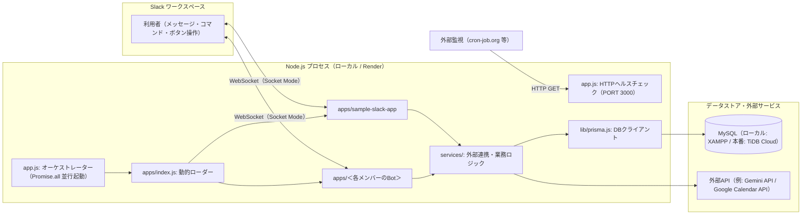

# コンポーネント仕様書（設計書群の入口）

## 1. 位置づけ

本書は、`slack-extension-app`（Slack Bot マルチ相乗り基盤）の設計書群への**入口**です。
ルール（コーディング規約・完了ゲート・禁止事項）の正本はルートの [`AGENTS.md`](../../AGENTS.md) であり、本書以下の設計書はその背景となる構造・責務・プロセスを説明します。

| 読者 | 最初に読む文書 |
| :--- | :--- |
| 新規参加者（開発メンバー） | 本書 → [`BASIC_DESIGN.md`](BASIC_DESIGN.md) → [`DETAIL_DESIGN.md`](DETAIL_DESIGN.md) |
| 機能追加担当 | [`README.md`](README.md) → `SPEC-NNNN` → [`LIBRARY_ARCHITECTURE_SPEC.md`](LIBRARY_ARCHITECTURE_SPEC.md) |
| レビュアー | [`BASIC_DESIGN.md`](BASIC_DESIGN.md) → [`LIBRARY_ARCHITECTURE_SPEC.md`](LIBRARY_ARCHITECTURE_SPEC.md) → 対象 `SPEC-NNNN` |
| チームリーダー（デプロイ・障害対応） | [`PROCESS_DESIGN.md`](PROCESS_DESIGN.md) → [`wiki-setup-and-deployment-guide.md`](../wiki-setup-and-deployment-guide.md) の【参考】Render 節 |

---

## 2. 設計書一覧

| 文書 | 用途 |
| :--- | :--- |
| [`COMPONENT_SPEC.md`](COMPONENT_SPEC.md) | 本書。設計書群の入口とシステム俯瞰 |
| [`BASIC_DESIGN.md`](BASIC_DESIGN.md) | 目的、利用者、中核ルール、非機能方針、トレードオフ |
| [`DETAIL_DESIGN.md`](DETAIL_DESIGN.md) | ディレクトリ構成、主要モジュール、環境変数、データモデル |
| [`PROCESS_DESIGN.md`](PROCESS_DESIGN.md) | Slackイベント処理フロー、開発・検証・障害対応フロー |
| [`LIBRARY_ARCHITECTURE_SPEC.md`](LIBRARY_ARCHITECTURE_SPEC.md) | 各レイヤの責務境界と依存ルール |
| [`TEMPLATE.md`](TEMPLATE.md) | 機能別仕様書（`SPEC-NNNN-*.md`）のテンプレート |
| [`reference/`](reference/README.md) | 外部参照資料・元資料置き場 |

---

## 3. システム概要

1つの Node.js プロセス（＝1つの Render Web Service）上で、`apps/` 配下に置かれた複数の Slack Bot を **Socket Mode** で同時稼働させる基盤です。
HTTP ヘルスチェックサーバーを内蔵し、Render 無料枠のスリープ防止と死活監視に対応します。

---

## 4. 技術スタック

| 項目 | 採用技術・バージョン | 備考 |
| :--- | :--- | :--- |
| 言語・実行環境 | Node.js 18 以上（推奨 20 LTS）/ ES Modules（`"type": "module"`） | `require` 禁止、相対インポートは `.js` 拡張子必須 |
| Slack フレームワーク | `@slack/bolt` v5（Socket Mode） | Bot ごとに `App` インスタンスを生成 |
| データベース | MySQL 互換（ローカル: XAMPP MariaDB / 本番: TiDB Cloud Serverless） | 接続先は `DATABASE_URL` で切替 |
| ORM | Prisma 7（`@prisma/client` + `@prisma/adapter-mariadb`） | スキーマ反映は `npx prisma db push` |
| 環境変数 | `dotenv` | `.env` は Git 管理外、`.env.sample` を雛形として共有 |
| テスト | Node.js 標準テストランナー（`node:test` / `node:assert`） | 外部パッケージのテストフレームワークは追加しない |
| 静的解析・整形 | Biome（スペース2・シングルクォート・LF・120桁） | `npm run lint` / `npm run lint:fix` |
| ホスティング | Render（Web Service / Free） | デプロイはチームリーダーのみが実施 |

実装規約の正本は [`AGENTS.md`](../../AGENTS.md)、タスク別の手順は [`.agents/skills/`](../../.agents/skills/) を参照してください。

---

## 5. 境界と信頼線

| 境界 | 方針 |
| :--- | :--- |
| Bot と Bot | 各 Bot は `apps/<app-name>/` に閉じ、他 Bot のファイルを import しない。1つの Bot の失敗が他 Bot・プロセス全体に波及しないこと（Fault Isolation）を最優先する |
| オーケストレーター と Bot | `app.js` / `apps/index.js` は Bot 固有の処理を持たない。Bot は `initApp(env, options)` という共通インターフェースだけで接続する |
| Slack 境界 と 業務ロジック | リスナーは `ack()`・入力の取り出し・サービス呼び出し・Slackへの返信に徹し、外部API呼び出しや計算はサービス層へ分離する |
| Slack からの入力 | ユーザーID・チャンネルID・入力値は Slack のペイロードから取得し、プロンプトやDBクエリへ渡す前に検証・整形する（生SQLの文字列連結は禁止） |
| 秘密情報 | Slack トークン・APIキー・DB接続URLは環境変数でのみ受け取り、コード・`.env.sample`・テスト・ログに実値を含めない |

