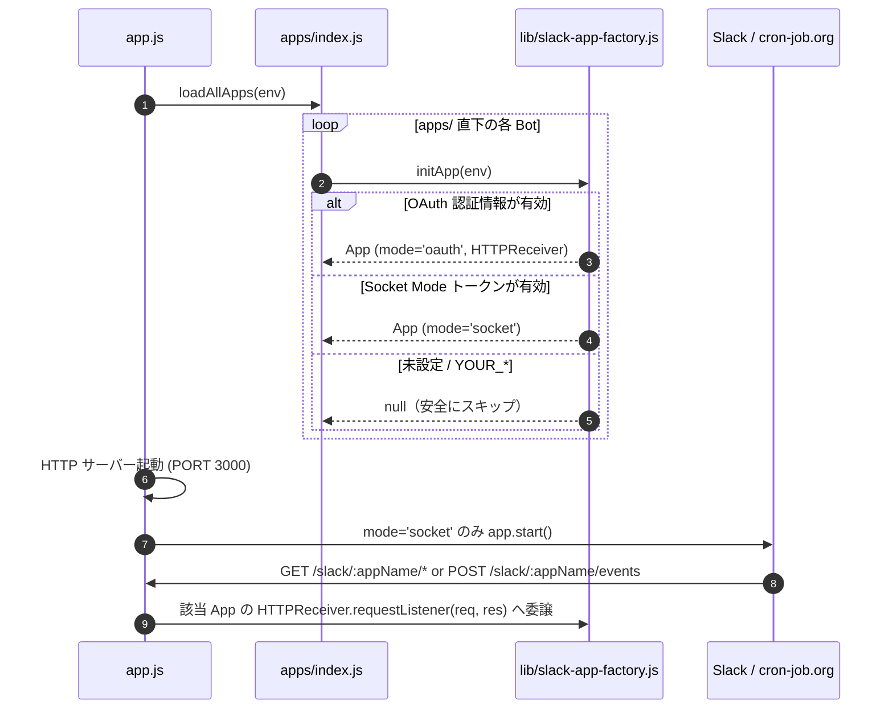
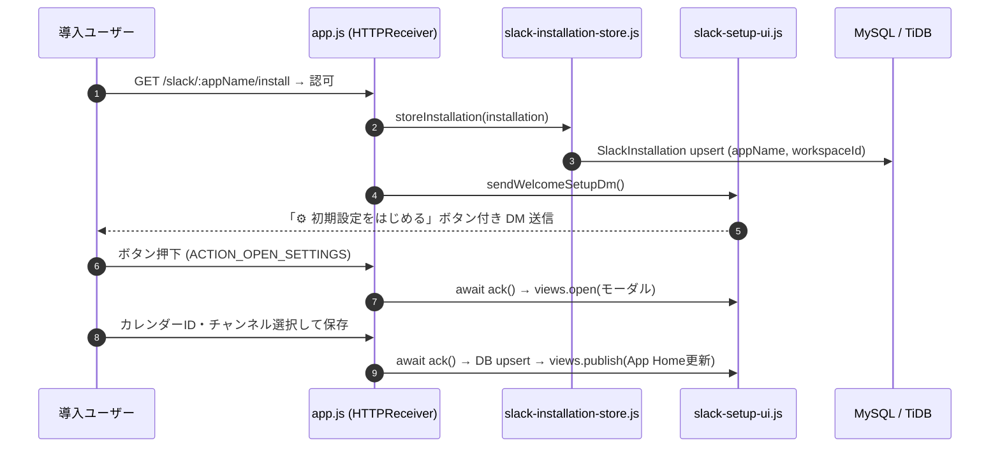
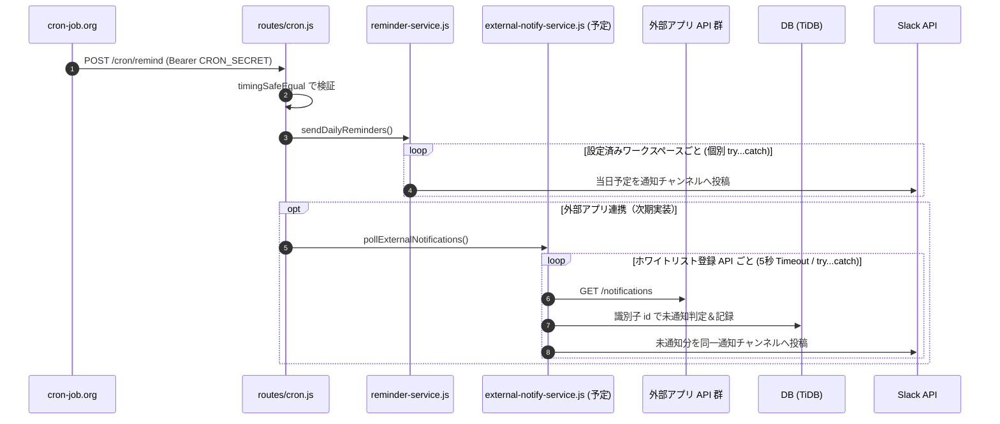

# 詳細設計書（DETAIL DESIGN / 軽量・ハイブリッド型）

## 1. 目的

本書は「軽量・ハイブリッド型」の方針に基づき、**ディレクトリ構成、主要モジュールインターフェイス、環境変数、データモデル（`prisma/schema.prisma`）、非同期・外部連携を伴う主要シーケンス図、および変更時の更新対象マトリクス** を定義します。
（※ 単純な関数・メソッド仕様は各ソースコード内の JSDoc コメントを正本とします）

---

## 2. ディレクトリ構成

| パス | 役割 |
| :--- | :--- |
| `app.js` | エントリポイント兼統合 HTTP サーバー（`PORT \|\| 3000`）。ヘルスチェック、`POST /cron/remind`、各 Bot の `/slack/<appName>/*` 動的ルーティング、Socket Mode 並列起動 |
| `apps/index.js` | `apps/` 直下を走査し、各 Bot の `initApp(env, options)` を呼び出す動的ローダー |
| `apps/message-calendar-bot/` | Bot①：Slack 投稿リアクション起点の予定登録・削除 Bot（詳細実装は個別要件確定後） |
| `apps/calendar-reminder-bot/` | Bot②：定期リマインド＆外部アプリ Pull 型通知 Bot（`services/reminder-service.js` 等） |
| `lib/prisma.js` | 共有 PrismaClient シングルトン（`DATABASE_URL` 未設定時は `null`） |
| `lib/slack-installation-store.js` | `@slack/bolt` 互換の Prisma ベース OAuth `InstallationStore`（`appName` + `workspaceId`） |
| `lib/slack-app-factory.js` | OAuth 本番配布モード（`HTTPReceiver` + インストール直後 DM）と Socket Mode の両対応ファクトリ |
| `lib/slack-setup-ui.js` | 3機能共通の App Home ダッシュボード、設定モーダル、ウェルカム DM 送信処理 |
| `lib/google-calendar.js` | サービスアカウント JWT 認証による Google カレンダー操作＆ワークスペース設定保存 |
| `lib/gemini.js` | Gemini API 連携共通インターフェイス（`MOCK_GEMINI=true`・`GEMINI_MODEL` 切替対応予定） |
| `routes/cron.js` | `POST /cron/remind` ハンドラー（`CRON_SECRET` タイミングセーフ検証付き） |
| `prisma/schema.prisma` | DB スキーマ定義（`provider = "mysql"`、全テーブル `id` 主キー・`createdAt`/`updatedAt`・日本語コメント必須） |
| `prisma/migrations/` | Prisma Migrate によるマイグレーション SQL 履歴 |
| `prisma7.config.ts` | Prisma 7 設定ファイル |
| `gas/excel-calendar-importer/` | GAS Web アプリ（モノレポ同居：`code.gs`, `index.html`, `appsscript.json` ※タスク3で配置予定） |
| `scripts/create-app.js` | `npm run create:app <app-name>` で新規 Bot 雛形を生成する CLI |
| `tests/` | `node:test` による単体テスト群（`*.spec.js`） |

---

## 3. 主要モジュールのインターフェイス

### 3.1 Bot 初期化関数 `initApp(env, options)`
- **実装**: `apps/<app-name>/index.js` から `lib/slack-app-factory.js` の `createMultiModeSlackApp` を呼び出す。
- **判定優先順**:
  1. `<PREFIX>_CLIENT_ID`, `<PREFIX>_CLIENT_SECRET`, `<PREFIX>_SIGNING_SECRET` が有効 ➔ **OAuth モード（`HTTPReceiver`）**
  2. `<PREFIX>_BOT_TOKEN`, `<PREFIX>_APP_TOKEN` が有効 ➔ **Socket Mode**（ローカル個人開発用）
  3. いずれも未設定／`YOUR_*` プレースホルダー ➔ 例外を投げず **`null`** を返却して安全にスキップ。
- **テスト時**: `env.NODE_ENV === 'test'` のとき `tokenVerificationEnabled: false`。

### 3.2 リスナーコールバック標準契約
- **配置**: `apps/<app-name>/listeners/<category>/<kebab-case>.js`（名前付きエクスポート）
- **必須事項**:
  1. 全体を `try...catch` で囲み、`catch` で `logger.error(error)` を記録。
  2. `actions` / `shortcuts` / `views` は `try` の冒頭で `await ack()` を実行。
  3. 入口で Slack の `teamId` / `team_id` を `workspaceId` へ読み替えてサービス層・`lib/` へ渡す。

---

## 4. 環境変数一覧

| 変数名 | 用途 | 必須 | 備考 |
| :--- | :--- | :---: | :--- |
| `DATABASE_URL` | MySQL / TiDB 接続 URL | DB利用時 | ローカル: `mysql://root:@localhost:3306/slack_app_db` |
| `GEMINI_API_KEY` | Gemini API キー | AI利用時 | 開発時は無料枠キー（架空データのみ）／本番は有料枠 |
| `MOCK_GEMINI` | `true` 指定で AI 通信をモック化 | 任意 | タスク3で実装予定（日常開発・`npm test` 用） |
| `GEMINI_MODEL` | Bot 用 Gemini モデル上書き | 任意 | タスク3で実装予定（既定: `gemini-3.5-flash-lite`） |
| `GOOGLE_SERVICE_ACCOUNT_EMAIL` | Google サービスアカウントメール | カレンダー時 | チーム共通アカウント（`akitacore.stamina@gmail.com`）で発行 |
| `GOOGLE_PRIVATE_KEY` | Google サービスアカウント秘密鍵 | カレンダー時 | `\n` を含めダブルクォーテーションで1行記述 |
| `CRON_SECRET` | `POST /cron/remind` 認証用シークレット | Cron利用時 | 任意のランダム文字列（`timingSafeEqual` で検証） |
| `<PREFIX>_CLIENT_ID` / `_CLIENT_SECRET` / `_SIGNING_SECRET` / `_STATE_SECRET` | OAuth 2.0 配布用認証情報 | 本番配布時 | `<PREFIX>` は `MESSAGE_CALENDAR_BOT`, `CALENDAR_REMINDER_BOT` |
| `<PREFIX>_BOT_TOKEN` / `_APP_TOKEN` | ローカル開発用 Socket Mode トークン | 開発時 | OAuth 用が未設定（`YOUR_*`）の場合に使用 |
| `EXTERNAL_NOTIFY_SOURCES` | 外部アプリ連携巡回先 JSON 配列 | 外部連携時 | タスク3以降で詳細確定後に実装予定（TBD） |
| `PORT` / `NODE_ENV` | サーバーポート（既定 `3000`）/ 実行モード | 任意 | `NODE_ENV=test` で外部検証を抑止 |

---

## 5. データモデル（`prisma/schema.prisma`）

### 5.1 現行モデル（マイグレーション `20261113060830_init` 適用対象）

| モデル名（テーブル名） | 主なカラム | 役割・制約 |
| :--- | :--- | :--- |
| **`SlackInstallation`** (`slack_installations`) | `id` (PK), `appName`, `workspaceId`, `workspaceName`, `enterpriseId`, `botToken`, `botId`, `botUserId`, `botScopes`, `installedUserId`, `createdAt`, `updatedAt` | ワークスペースごとの Bot OAuth トークンを管理。`@@unique([appName, workspaceId])` により複数 Bot のトークンを分離保存 |
| **`WorkspaceCalendarConfig`** (`workspace_calendar_configs`) | `id` (PK), `workspaceId` (Unique), `googleCalendarId`, `reminderChannelId`, `updatedByUserId`, `createdAt`, `updatedAt` | ワークスペース単位の連携先 Google カレンダー ID とリマインド／外部通知先チャンネル ID を保持 |

### 5.2 次期追加予定モデル（TBD：詳細設計確定後にマイグレーション追加）
- **複数カレンダー対応テーブル / カラム**: `message-calendar-bot` のワークスペース内複数カレンダー選択機能向け（新規テーブル `workspace_calendars` または既存テーブル拡張を今後決定）。
- **外部アプリ通知済み識別子テーブル**（仮称：`ExternalNotificationHistory`）: `sourceId` + `workspaceId` + `externalEventId` で重複通知を防止。

---

## 6. 主要処理シーケンス図

### 6.1 起動 ＆ HTTP リクエスト振り分けシーケンス

### 6.2 OAuth インストール ＆ GUI 初期設定シーケンス

### 6.3 定期実行（リマインド ＆ 外部アプリ Pull 型通知）シーケンス（※外部連携は設計中）

---

## 7. 変更時の更新対象マトリクス

| 変更種別 | 同一 PR で更新必須の対象 |
| :--- | :--- |
| 新規 Bot 追加 | `apps/<app-name>/` 一式 + `.env.sample` + テスト（`create-slack-app` スキル） |
| リスナー・UI 追加変更 | リスナー + `manifest.json`（スコープ・イベント・Interactivity）+ テスト（`add-slack-listener` スキル） |
| 外部 API・環境変数追加 | サービス + テスト + `.env.sample` + 本書「4. 環境変数一覧」 |
| DB スキーマ変更 | `prisma/schema.prisma` + `prisma/migrations/`（`migrate dev`）+ テスト + 本書「5. データモデル」 |
| 全体方針・構成変更 | `AGENTS.md` + `README.md` + [`BASIC_DESIGN.md`](BASIC_DESIGN.md) + 本書 |
