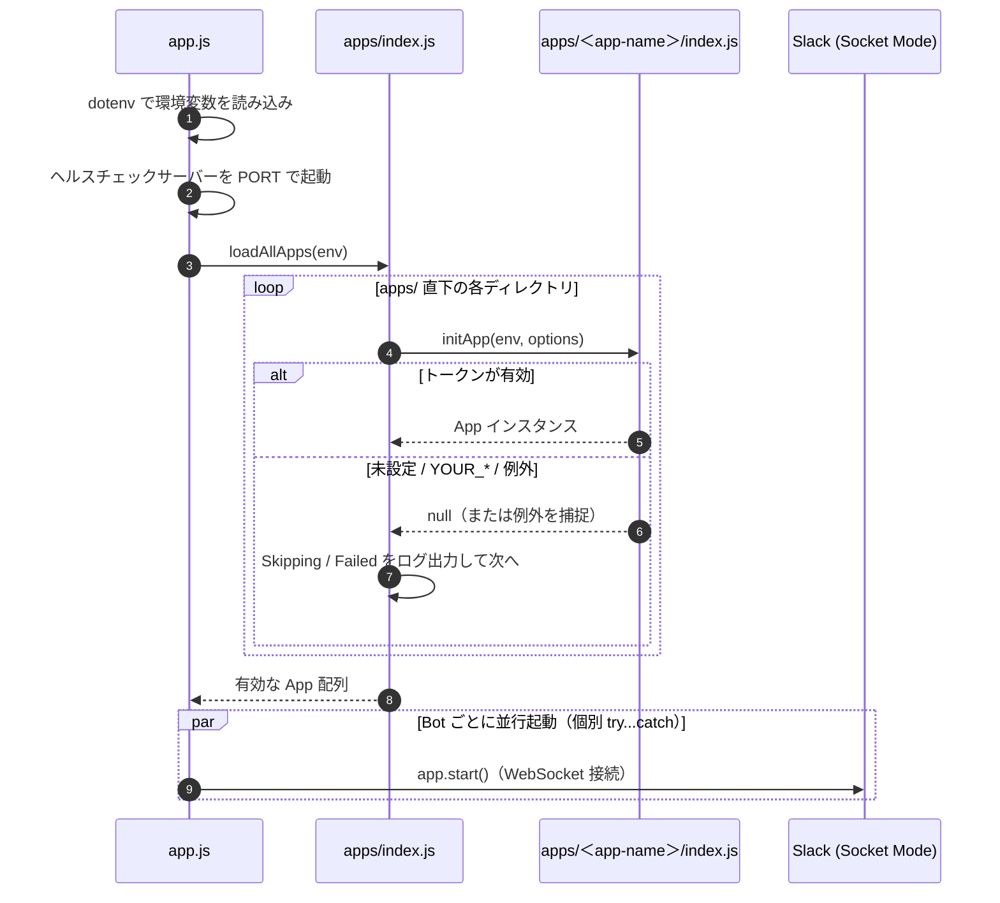
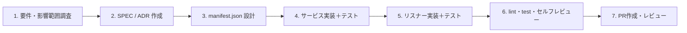

# プロセス設計書

## 1. 目的

本書は、Slack イベント処理の**実行時プロセス**と、**開発・検証・変更管理・障害対応のプロセス**を定義します。

---

## 2. 実行時プロセス

### 2.1 起動シーケンス

### 2.2 イベント処理の設計原則

1. **即時応答**: `commands` / `actions` / `shortcuts` / `views` は最初に `await ack()` を返す。`events` / `messages` は Bolt が自動で ack する。
2. **重い処理は ack の後**: LLM・外部API・DB更新など数秒かかる処理は ack 後に実行し、結果はスレッド返信（`thread_ts`）や `respond()` で通知する。
3. **失敗の可視化**: 例外は `logger.error` で記録し、利用者には「処理に失敗した」ことが分かるメッセージを返す。トークンや内部スタックトレースは返信に含めない。
4. **二重処理の防止**: 外部への登録（例: カレンダー登録）を伴う処理は、同じメッセージ・同じ操作で重複登録されないよう、一意キー（チャンネルID + メッセージ `ts` など）で判定する。
5. **外部処理と確定の順序**: 外部APIの成功を確認してから「完了」を通知する。外部処理は成功したが自システム側の記録に失敗した場合は、単なる失敗ではなく要確認としてログに残し、手動で復旧できるようにする。

---

## 3. 標準開発プロセス

1. **要件・影響範囲調査**: 対象 Bot、必要な Slack スコープ・イベント、外部サービス、追加する環境変数を洗い出す。基盤コード（`app.js` / `apps/index.js` / `lib/`）に影響する場合は必ずレビュアーへ事前共有する。
2. **仕様・判断の明文化**: `docs/specs/SPEC-NNNN-*.md` に受け入れ条件（AC）を記述する。後戻りしにくい判断は [`private/docs/adr/`](../../private/docs/adr/README.md) に起票する。
3. **Manifest 設計**: `manifest.json` に必要なスコープ・イベント・コマンドを追加する（ローカル検証用の個人テストアプリにも反映する）。
4. **ボトムアップ実装**: 原則として「サービス（＋単体テスト）→ リスナー（＋単体テスト）→ 登録（`register` / `registerListeners`）」の順に進める。
5. **セルフレビューと検証**: [`code-review-and-qa`](../../.agents/skills/code-review-and-qa/SKILL.md) のゲートに従い、`npm run lint`（エラー0件）と `npm test`（失敗0件）を確認する。
6. **PR作成**: [`pr-splitting.md`](../guidelines/pr-splitting.md) の基準で分割し、PR本文に変更概要・追加環境変数・manifest 変更の有無・テスト結果を記載する。

### 3.1 複数人での並行開発

- 同じ Bot のトークンを複数人で同時に使わない。担当 Bot を分けるか、開発者ごとに個人テスト用の Slack App を作成してトークンを分ける（詳細: [`wiki-setup-and-deployment-guide.md`](../wiki-setup-and-deployment-guide.md) 5.4節）。
- ローカルDB（XAMPP）は各自のPC内で完結させ、本番DBへ開発中のコードから接続しない。

---

## 4. 変更管理ルール

| 変更種別 | 更新必須のドキュメント |
| :--- | :--- |
| 機能仕様の追加・変更 | `docs/specs/SPEC-NNNN-*.md` |
| システム全体構成・レイヤ責務の変更 | `BASIC_DESIGN.md` / `DETAIL_DESIGN.md` / `LIBRARY_ARCHITECTURE_SPEC.md` |
| 環境変数・データモデルの変更 | `DETAIL_DESIGN.md` + `.env.sample` |
| 起動・開発・デプロイ手順の変更 | 本書 + `README.md` + 該当する `docs/wiki-*.md` |
| AI エージェント向けルールの変更 | `AGENTS.md`（および影響するスキルを `.agents/skills/` と `.claude/skills/` の両方で更新） |
| アーキテクチャ上の意思決定 | `private/docs/adr/ADR-NNNN-*.md` |

---

## 5. デプロイプロセス（チームリーダーのみ）

1. `main` ブランチへマージ後、Render が自動で再ビルド・再デプロイする。
2. 新しい Bot・環境変数を追加した場合は、デプロイ前に Render の Environment に本番トークン・APIキーを登録する。
3. デプロイ後、Render のログで `⚡️ Bolt app (<app-name>) is running!` と `Skipping app` / `Failed to start app` の有無を確認する。
4. 問題があれば Render のダッシュボードから直前のデプロイへロールバックする。

---

## 6. 障害対応プロセス

1. **一次切り分けと記録**: 発生時刻、対象 Bot、症状（無反応・エラー返信・二重返信）、再現手順、起動ログ（`Skipping` / `Failed to load` / `Failed to start`）を記録する。
2. **影響範囲の確認**: 他の Bot とヘルスチェックが正常に動いているか確認する。プロセス全体が停止している場合は障害隔離の不備として最優先で扱う。
3. **暫定対応と恒久対応の分離**: 暫定対応として該当 Bot のトークンを環境変数から外して切り離し（安全にスキップされる）、他 Bot の稼働を維持したまま恒久対応を進める。
4. **再発防止の還流**: 原因と対策を ADR に記録し、必要に応じて `AGENTS.md`・スキル・`LIBRARY_ARCHITECTURE_SPEC.md` の自己点検リストへ反映する。

