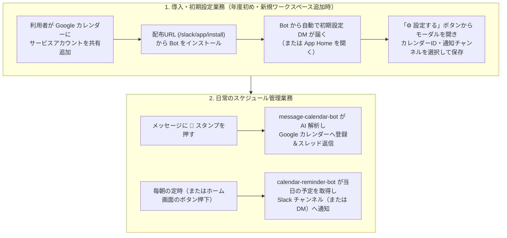
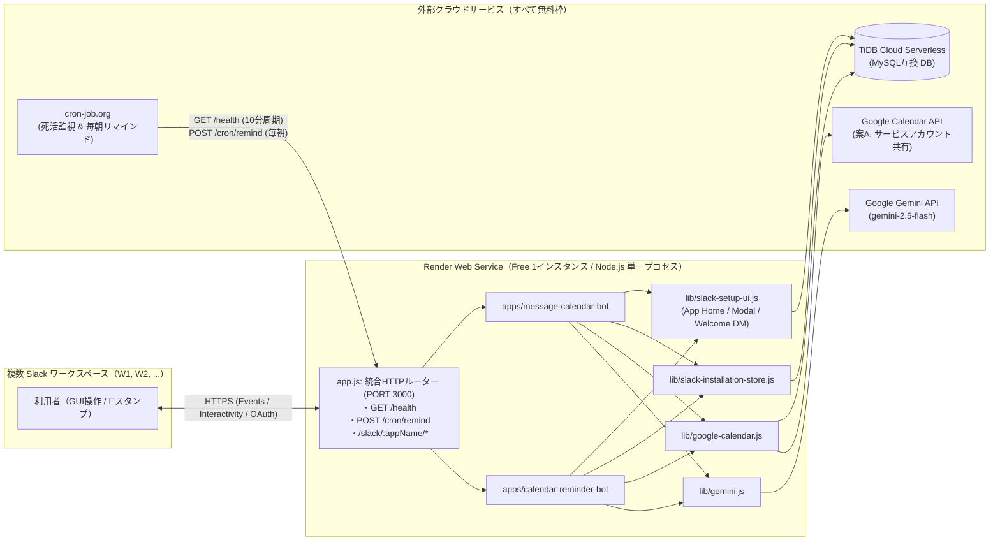

# 要件定義書（REQUIREMENTS）

> **文書の位置づけ**  
> 本書は、技術者・非技術者（利用者・意思決定者・開発メンバー）が「このシステムで何を実現し、何をやらないか（対象外とするか）」の共通認識を持つための最上位ドキュメントです。  
> （構成参考：[「要件定義書」を作成してみる - Qiita (@minimumskills)](https://qiita.com/minimumskills/items/f9589953d48118d9f71f)）

---

## 目次

1. [システム化（開発）の目的と範囲](#1-システム化開発の目的と範囲)
2. [業務要件](#2-業務要件)
   - [2.1 業務要件一覧](#21-業務要件一覧)
   - [2.2 業務要件フロー図](#22-業務要件フロー図)
3. [機能要件](#3-機能要件)
   - [3.1 機能要件一覧（外部機能 ／ 内部機能）](#31-機能要件一覧外部機能--内部機能)
   - [3.2 機能と配置イメージ（システム全体像）](#32-機能と配置イメージシステム全体像)
   - [3.3 各機能の詳細補足](#33-各機能の詳細補足)
4. [非機能要件](#4-非機能要件)
   - [4.1 非機能要件一覧（定義しない項目を含む）](#41-非機能要件一覧定義しない項目を含む)
   - [4.2 可用性・障害隔離](#42-可用性障害隔離)
   - [4.3 性能・キャパシティ](#43-性能キャパシティ)
   - [4.4 セキュリティ](#44-セキュリティ)
   - [4.5 移行性・運用・保守性](#45-移行性運用保守性)
   - [4.6 プロジェクト上の留意事項・制約条件](#46-プロジェクト上の留意事項制約条件)

---

## 1. システム化（開発）の目的と範囲

### 1.1 背景と目的
複数の Slack ワークスペース（年度ごとに新設されるワークスペースや複数チームのワークスペース）において、予定の登録漏れや確認漏れを防ぎ、スケジュール管理業務を自動化するため、以下の **2つの AI × Google カレンダー連携 Slack Bot** を開発・配布します。

1. **`message-calendar-bot`**: Slack メッセージから AI が予定を読み取り、Google カレンダーへ自動登録する。
2. **`calendar-reminder-bot`**: Google カレンダーの当日予定を取得し、Slack チャンネルへ毎朝リマインド通知する。

また、サーバー・データベース・AI API・定期実行のすべてを **無料枠（Free Tier）の範囲内** で運用し、年度替わり等で新しいワークスペースへ導入する際も **開発者の手作業（トークン取得・環境変数設定・再デプロイ）なしで導入できる仕組み（本格配布レベル1：OAuth 2.0 Direct Install）** を実現します。

### 1.2 システム化の範囲（スコープ定義）

要件の認識齟齬を防ぐため、「今回対応する範囲」と「今回は定義・実装しない範囲（対象外）」を明確に定義します。

| 区分 | 項目 | 対象可否 | 備考・理由 |
| :--- | :--- | :---: | :--- |
| **配布方式** | 配布用 URL（OAuth 2.0）による複数ワークスペースへの導入 | **⭕ 対象** | 本格配布レベル1（Direct Install）。2つの個別 Bot として配布 |
| **配布方式** | Slack Marketplace（旧 App Directory）への一般公開審査 | **❌ 対象外** | 特定組織・複数ワークスペースへの URL 配布で十分なため |
| **カレンダー連携** | ワークスペース共有 Google カレンダーへの予定登録・取得（案A） | **⭕ 対象** | チーム共通サービスアカウントを各カレンダーへ共有追加する方式 |
| **カレンダー連携** | 個人別の Google カレンダーに対する予定の追加・修正・削除 | **❌ 対象外** | ユーザー単位の Google OAuth 審査・トークン管理が必要なため、次期フェーズ以降の検討課題とする |
| **操作 UI** | Slack GUI（App Home・モーダル・ボタン・プルダウン）による設定 | **⭕ 対象** | 非エンジニアでも直感的に操作できるよう GUI に一本化 |
| **操作 UI** | スラッシュコマンド（`/set-calendar` 等）による設定 | **❌ 対象外** | コマンド暗記の負担をなくすため廃止（GUI に統合） |
| **対象入力** | Slack チャットメッセージからの予定抽出 | **⭕ 対象** | 📅 スタンプが付与されたテキストメッセージを解析対象とする |
| **対象入力** | Excel・PDF・Word・画像ファイルからの予定抽出 | **❌ 対象外** | 現フェーズではテキストメッセージのみ対象（Excel 年間予定連携は対象外に変更） |

---

## 2. 業務要件

### 2.1 業務要件一覧

| 要件ID | 業務分類 | 業務要件名 | 概要 | 主な実施者 |
| :--- | :--- | :--- | :--- | :--- |
| **BR-01** | 導入・初期設定 | ワークスペースへの Bot 導入 | 年度替わりや新規チーム発足時、管理者に依頼せず配布 URL から必要な Bot（2種のうち任意）をワークスペースへ追加できること | ワークスペース利用者 |
| **BR-02** | 導入・初期設定 | Google カレンダーとの紐付け設定 | チームの Google カレンダーに Bot 用サービスアカウントを共有追加し、Slack の画面（GUI）からカレンダー ID と通知先チャンネルを設定できること | ワークスペース利用者 |
| **BR-03** | 日常業務 | チャットメッセージからの予定登録（詳細 TBD） | `message-calendar-bot` によりメッセージから AI で予定を抽出し Google カレンダーへ登録すること（具体的なトリガー条件・プロンプト・返信形式は今後定義） | ワークスペース利用者 |
| **BR-04** | 日常業務 | 予定のリマインド通知（詳細 TBD） | `calendar-reminder-bot` により Google カレンダーの予定を取得し Slack へ通知すること（通知タイミング・対象範囲・メッセージ形式は今後定義） | ワークスペース利用者 |
| **BR-05** | 保守・運用 | マルチ Bot 相乗り環境の監視・DB 変更管理 | 1つの無料サーバー上で複数 Bot の稼働状態を把握でき、DB 設計変更時はマイグレーション履歴によって安全にチーム・本番環境へ反映できること | 開発チーム・管理者 |

### 2.2 業務要件フロー図

---

## 3. 機能要件

### 3.1 機能要件一覧（外部機能 ／ 内部機能）

#### （1）外部機能（目に見える機能：画面・UI・Slack 通知）

| 要件ID | 対象アプリ / 領域 | 機能名 | 機能概要 |
| :--- | :--- | :--- | :--- |
| **FR-E01** | 全 Bot 共通 | OAuth インストール画面 | `/slack/<appName>/install` にアクセスした際、Slack 公式のワークスペース認可画面へリダイレクトする |
| **FR-E02** | 全 Bot 共通 | インストール直後ウェルカム DM | OAuth インストール完了直後、導入ユーザー宛に「⚙️ 初期設定をはじめる」ボタン付きの案内 DM を自動送信する |
| **FR-E03** | 全 Bot 共通 | App Home 設定ダッシュボード | 各 Bot の「ホーム」タブに、現在の連携カレンダー ID・通知先チャンネル・共有用サービスアカウントアドレス・設定ボタンを表示する |
| **FR-E04** | 全 Bot 共通 | カレンダー・通知先設定モーダル | 設定ボタン押下でポップアップを開き、カレンダー ID 入力と通知先チャンネルのプルダウン選択（`conversations_select`）を行える |
| **FR-E05** | `message-calendar-bot` | メッセージ予定登録（TBD・最小骨組み） | 現時点ではイベント受信の最小骨組み（`reaction_added`）のみ配置。具体的なトリガー・抽出プロンプト・返信 UI は再定義後に実装する |
| **FR-E06** | `calendar-reminder-bot` | 定期リマインド配信（TBD・骨組み） | 現時点では Cron 受信および当日の予定取得・整形の最小骨組みのみ配置。通知タイミング・対象条件・メッセージ形式は再定義後に調整する |
| **FR-E07** | `calendar-reminder-bot` | 当日予定のオンデマンド確認ボタン | App Home の「📅 今日の予定を今すぐ確認」ボタン押下時、押したユーザー宛てに当日の予定一覧を DM 送信する（詳細は再定義対象） |

#### （2）内部機能（目に見えない機能：データ・I/F・バッチ・外部連携）

| 要件ID | 対象モジュール | 機能名 | 機能概要 |
| :--- | :--- | :--- | :--- |
| **FR-I01** | `app.js` / `apps/index.js` | マルチ Bot 動的ローダー＆統合 HTTP ルーター | `apps/` 配下を自動走査し、1つのポート（`3000`）でヘルスチェック・Cron・各 Bot の OAuth / Events を振り分ける |
| **FR-I02** | `lib/slack-app-factory.js` | OAuth / Socket Mode 自動切替初期化 | 環境変数に応じて本番配布モード（`HTTPReceiver`）とローカル開発モード（`SocketMode`）を自動選択し、未設定時は `null` で安全にスキップする |
| **FR-I03** | `lib/slack-installation-store.js` | ワークスペース別 OAuth トークン永続化 | `SlackInstallation` テーブル（`appName` + `workspaceId` 複合ユニーク）へ Bot トークンを `upsert`・取得・削除する |
| **FR-I04** | `lib/gemini.js` | Gemini API 連携インターフェイス | `createGeminiClient` / `generateText` / `extractEventFromMessage` の共通 I/F を提供（具体的なプロンプト・JSON スキーマは TBD） |
| **FR-I05** | `lib/google-calendar.js` | Google カレンダー API 連携（案A） | サービスアカウント（JWT 認証）で対象ワークスペースのカレンダーへ予定登録・当日予定取得を行う共通 I/F を提供 |
| **FR-I06** | `routes/cron.js` | 日次リマインド配信バッチ受付 | `POST /cron/remind` で `CRON_SECRET` を検証し、設定済み全ワークスペースへ順次リマインドを配信する |

---

### 3.2 機能と配置イメージ（システム全体像）

### 3.3 各機能の詳細補足
各画面のレイアウト、データモデル（`SlackInstallation`, `WorkspaceCalendarConfig`）、環境変数一覧の詳細は [`DETAIL_DESIGN.md`](DETAIL_DESIGN.md) に定義します。

---

## 4. 非機能要件

### 4.1 非機能要件一覧（定義しない項目を含む）

後工程での認識違いを防ぐため、本プロジェクトで「定義する非機能要件」と「定義しない（対象外とする）非機能要件」を一覧化します。

| 分類 | 項目 | 定義有無 | 内容・理由 |
| :--- | :--- | :---: | :--- |
| **可用性** | スリープ防止・死活監視 | **⭕ 定義する** | `GET /health` を `cron-job.org` から10〜14分間隔で呼び出し、Render 無料枠のスリープを抑止する |
| **可用性** | 障害隔離（Fault Isolation） | **⭕ 定義する** | 1つの Bot または 1つのワークスペースのエラーが、他 Bot やプロセス全体を停止させない設計とする |
| **可用性** | 冗長化（マルチインスタンス構成）・SLA 保証 | **❌ 定義しない** | 無料枠（Render Free 1インスタンス）で運用するため、サーバー二重化や稼働率 SLA は設けない |
| **性能** | Slack 3秒タイムアウト対策 | **⭕ 定義する** | すべてのインタラクション（ボタン・モーダル）で冒頭に `await ack()` を実行する |
| **性能** | 大量同時アクセス時の負荷分散・オートスケール | **❌ 定義しない** | 対象ワークスペース内の日常業務利用であり、秒間数百リクエスト規模の高負荷は発生しないため |
| **セキュリティ** | 認証情報・秘密鍵の保護と通信検証 | **⭕ 定義する** | OAuth トークン・サービスアカウント鍵・`CRON_SECRET`（タイミングセーフ比較）の保護を徹底する |
| **移行性・保守** | DB マイグレーション管理 | **⭕ 定義する** | Prisma Migrate（`prisma/migrations/`）でスキーマ変更履歴を管理し、ロールフォワードで戻せる運用とする |
| **移行性・保守** | 旧システムからの既存データ移行 | **❌ 定義しない** | 新規構築システムであり、移行対象のレガシーデータが存在しないため |

---

### 4.2 可用性・障害隔離
1. **相乗り環境の安全性（Fault Isolation）**:
   - 特定の Bot の環境変数（OAuth 認証情報やトークン）が未設定・プレースホルダー（`YOUR_*`）の場合、例外を投げずに `null` を返してその Bot のみをスキップし、他の Bot は正常稼働させる。
   - すべてのイベント・アクション・モーダル・Cron ハンドラーを `try...catch` で囲み、未捕捉例外によるプロセス停止を防ぐ。
2. **マルチワークスペース間の隔離**:
   - 毎朝のリマインド配信において、特定の1ワークスペースでエラー（例: カレンダー共有設定漏れによる `403`/`404`）が発生してもループを中断せず、他ワークスペースへの処理を完遂する。

### 4.3 性能・キャパシティ
1. **Slack 3秒ルールの遵守**:
   - `actions` / `views` 等のインタラクティブ通信では、`try` ブロックの最初に `await ack()` を呼び出して Slack 側のタイムアウトエラーを防止する。
2. **AI トークン消費の抑制**:
   - 全メッセージを常時 AI 解析するのではなく、「📅 スタンプが押されたメッセージ」のみを Gemini API へ送信し、無料枠のレート制限内に収める。

### 4.4 セキュリティ
1. **秘密情報の管理**:
   - Slack の `CLIENT_SECRET` / `SIGNING_SECRET` / `BOT_TOKEN`、Google サービスアカウント秘密鍵（`GOOGLE_PRIVATE_KEY`）、`GEMINI_API_KEY`、`CRON_SECRET` は環境変数または DB（`slack_installations`）でのみ保持し、ソースコードや `.env.sample`、ログには一切出力しない。
2. **Cron エンドポイントの保護**:
   - `POST /cron/remind` は `Authorization: Bearer <CRON_SECRET>`（または `x-cron-secret`）を `crypto.timingSafeEqual` で検証し、未設定時は `503`、不一致時は `401` で拒否する。

### 4.5 移行性・運用・保守性
1. **Prisma Migrate による DB スキーマ管理**:
   - スキーマ変更時は `npx prisma db push` を使わず、`npx prisma migrate dev --name <name> --config prisma7.config.ts` でマイグレーション SQL を生成・Git 管理する。
   - 本番環境（TiDB Cloud）への適用は `npx prisma migrate deploy --config prisma7.config.ts` を使用する。変更を元に戻す場合は、元の状態へ戻す新しいマイグレーションファイルを作成（ロールフォワード）する。
2. **初学者に配慮したコード品質と機械的ゲート**:
   - ファイル・ディレクトリ名はすべてケバブケースとする。
   - すべてのテーブルに `id`（自動採番主キー）、`createdAt`、`updatedAt`、および各カラムの日本語説明コメントを記載する。
   - Slack 内部の `teamId` / `teamName` は境界（OAuth ストア・リスナー入口）で吸収し、アプリ内コードおよび DB カラムはすべて `workspaceId` / `workspaceName` に統一する。
   - `npm run lint`（Biome エラー 0件）および `npm test`（単体テスト失敗 0件）を PR マージの必須条件とする。

### 4.6 プロジェクト上の留意事項・制約条件
1. **無料インフラ枠の制約**:
   - Render Free Web Service はアカウント全体で月 750 時間の上限があるため、2つの Bot を別々の Render サービスとして立てず、必ず本リポジトリの単一プロセス（`app.js`）に同居させてデプロイする。
2. **Google API 管理アカウント**:
   - Google Cloud プロジェクト（Google Calendar API・サービスアカウント発行）および Gemini API キーの管理には、個人の Google アカウントではなくチーム共通アカウント（`akitacore.stamina@gmail.com`）を使用する。
